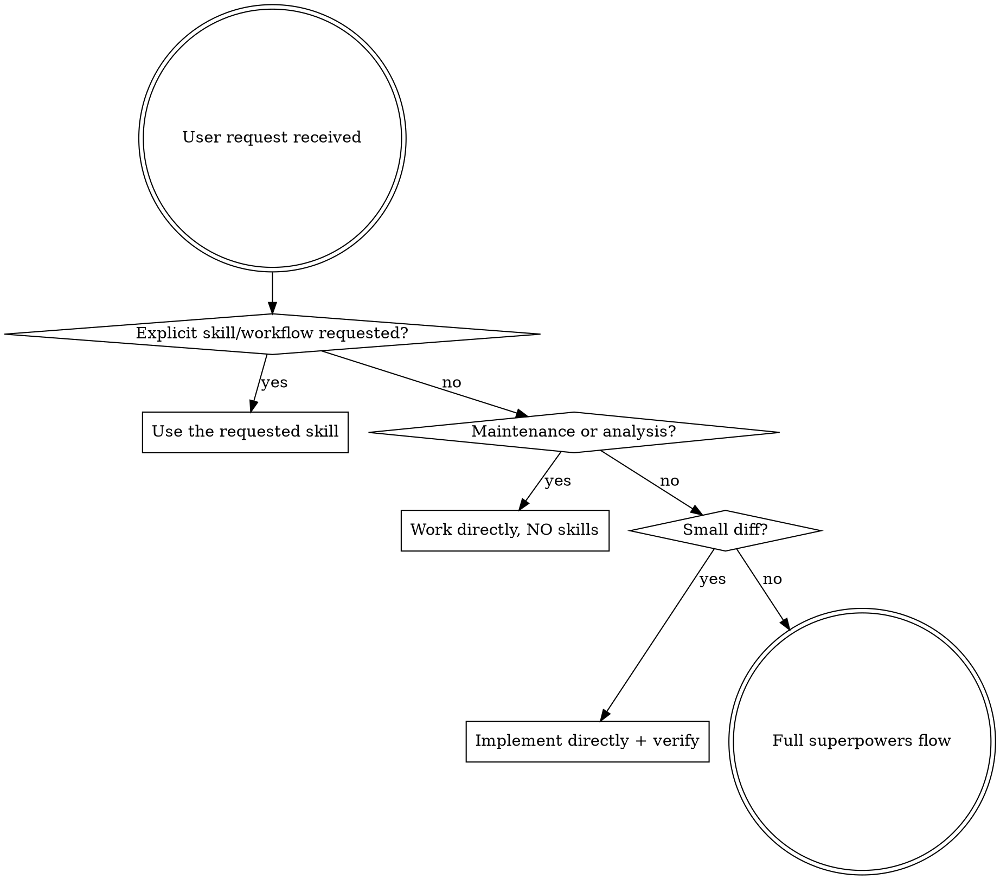

<SUBAGENT-STOP>
If you were dispatched as a subagent to execute a specific task, skip this skill.
</SUBAGENT-STOP>

## Instruction Priority

Superpowers skills override default system prompt behavior, but **user instructions always take precedence**:

1. **User's explicit instructions** (AGENTS.md, CLAUDE.md, project settings, direct requests) — highest priority
2. **Superpowers skills** — override default system behavior where they conflict
3. **Default system prompt** — lowest priority

If the user explicitly names a skill or workflow ("use brainstorming", "run the audit skill", "make a plan first"), use it regardless of the triage below. If the user says "just do it" / "no brainstorming", skip the full flow.

## How to Access Skills

**In pi:** Use the `read` tool to load a skill's SKILL.md file, or use `/skill:name` commands. Skills are discovered automatically at startup and listed in the system prompt. When a task matches a skill's description, load and follow it.

## Platform Adaptation

Skills were originally written for Claude Code. In pi, use the `read` tool for loading skills/files, `bash` for running commands, `edit` for file changes, and `write` for creating files. When `@tintinweb/pi-subagents` is installed, use it for isolated subagent workflows (Agent, get_subagent_result, steer_subagent tools); otherwise adapt skills to sequential execution or other Pi-native mechanisms.

# Triage First

**Before loading any other skill, classify the user's initial request.** The triage decides whether skills are used at all. It overrides the "MUST"/"any"/"always" wording in individual skill descriptions (brainstorming, test-driven-development, writing-plans, etc.) — those apply only on the full-flow path.

Announce the result in one short line so the user can redirect, e.g. `Triage: small diff → working directly.` Then act. Do not ask permission for the classification.

## Step 1 — Is it maintenance or analysis?

**Yes → do NOT load any skill.** Just do the work with normal tools.

**Analysis** — the deliverable is understanding, not changed behavior:
- Questions, explanations, "how does X work", "why does Y happen"
- Code reading, investigation, root-cause analysis without a requested fix
- Reviews, audits, comparisons, research, estimates
- Inspecting logs, metrics, CI output, git history, run status

**Maintenance** — upkeep that preserves intended behavior:
- Running builds/tests/linters/formatters and fixing their mechanical findings
- Dependency bumps, lockfile refreshes, toolchain/CI config tweaks
- Git housekeeping: commits, rebases, branch cleanup, conflict resolution
- Typos, renames, dead-code removal, comment/doc updates, moving files
- Re-running, retrying, cleaning up, regenerating artifacts

If the request mixes analysis with a fix ("investigate X and fix it"), do the analysis, then re-triage the fix with Step 2.

## Step 2 — Is it a small diff?

**Yes → implement directly**, no brainstorming, no spec, no plan document, no TDD ceremony. Still follow the project's verification rules (run relevant tests/build, check the result) before claiming done.

It is a small diff when **all** of these hold:
- The intended outcome is clear and unambiguous from the request (no real design choice for the user to make)
- There is one obvious approach that a reviewer would not question
- Roughly ≤ 3 files and ≤ ~100 changed lines
- No new public API, data model/schema, architecture, module boundary, or new dependency
- Low risk: easy to verify and easy to revert

Typical examples: a localized bug fix with a known cause, adding a flag/option following an existing pattern, tweaking a message/validation/default, a small UI adjustment, editing a skill or prompt the user described precisely.

If you start implementing and discover it is bigger than expected (scope grows, a genuine design decision appears, unknown root cause), **stop and escalate** to the full flow, telling the user why.

## Step 3 — Otherwise: full superpowers flow

Anything that is not maintenance/analysis and not a small diff goes through the full process:

1. **Process skill first:**
   - New features, new behavior, design decisions, multi-file or architectural changes → **brainstorming** (→ writing-plans → executing-plans / subagent-driven-development)
   - Bugs with unknown root cause, test failures, unexpected behavior → **systematic-debugging**
2. **Implementation skills second** (test-driven-development, frontend-design, rust-review, etc.) as they apply.
3. **Verification before completion** at the end.

On this path, skills are mandatory: if a skill applies, load it and follow it. Rigid skills (TDD, debugging) are followed exactly; flexible ones are adapted to context — the skill itself says which. If a skill has a checklist, track each item as a todo.

### Red flags (full-flow path only)

Once triage has routed you to the full flow, these thoughts mean you are rationalizing:

| Thought | Reality |
|---------|---------|
| "I'll just start coding, it'll become clear" | Non-small work needs a design first. Brainstorm. |
| "Let me explore the codebase first" | Brainstorming's first step IS exploring context. Load it. |
| "The skill is overkill" | Triage already decided it isn't. Use it. |
| "I remember this skill" | Skills evolve. Read the current version. |
| "I'll do this one thing first" | Load the process skill before acting. |

### Red flags (triage itself)

| Thought | Reality |
|---------|---------|
| "Better safe — brainstorm everything" | Over-processing small or maintenance work wastes the user's time. Respect the triage. |
| "It's small, but I'll write a spec anyway" | Small diff = implement and verify. No spec. |
| "It's a 2-line fix but touches a design question" | Then it isn't small. Full flow. |
| "Analysis request, but I'll also fix what I find" | Report findings; only change code if asked, then re-triage. |
